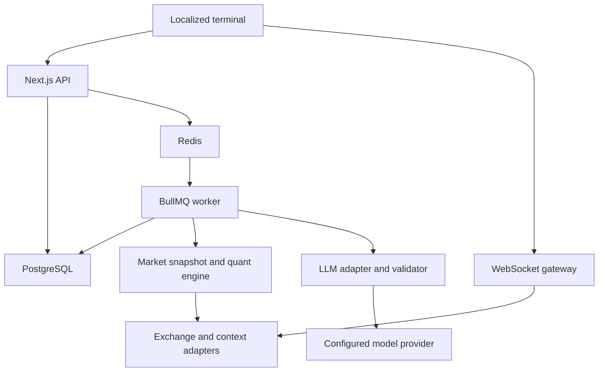

# Architecture

Next.js App Router provides the UI and tenant-scoped Node API. PostgreSQL is the source of truth; Redis caches shared market responses and carries drawing changes and live order-flow summaries. BullMQ schedules polling workers, while PostgreSQL claims analysis and research jobs with `FOR UPDATE SKIP LOCKED`. A separate `ws` gateway multiplexes exchange connections. Development substitutes a single-process PGlite database and embedded worker; it is not a multi-process production database.

## Technology decisions

| Component | Choice | Reason |
|---|---|---|
| Application | Next.js / TypeScript / React | Shared application, auth and tenant API; standalone deploy |
| UI | Tailwind, Radix dialog, shadcn-style components | Accessible primitives with dense responsive terminal styling |
| Chart | KLineCharts 9.8.12 | Open-source candles, indicator panes and editable overlays; no paid TradingView dependency |
| Backend | Node modules + Next routes | Reuses data/quant code in API and worker; separate gateway for persistent connections |
| Storage | PostgreSQL / parameterized SQL | Explicit transaction locking for quotas, job claiming and paper ledger; versioned SQL migrations instead of ORM abstraction |
| Cache / jobs | Redis / BullMQ | Distributed market cache, drawing pub/sub and scheduled maintenance |
| Validation | Zod / Ajv JSON Schema | Inputs validated before writes; strict AI JSON plus numerical checks |
| Monitoring | Redacted JSON logs, Sentry, Prometheus text endpoints | No provider keys, body, personal data or prompts sent to error sink |
| Delivery | Docker Compose / GitHub Actions | Reproducible local staging and documented CI release checks |

Adapters live in `packages/market/providers.mjs` and `packages/ai/agent.mjs`; public capabilities are shared functions rather than exchange-specific UI logic. `packages/providers/interfaces.ts` describes the extension boundary. Exchange symbols are deliberately USDT spot/perpetual instruments; add instrument normalization and quote-currency support before expanding the universe.

## Data and consistency

Historical OHLCV is paginated, deduplicated and validated. Closed bars are stored with a composite exchange/market/symbol/timeframe/time key. REST cache TTLs distinguish candles, depth, derivatives and context. Candle sockets reconnect with jitter; historical data reloads to heal gaps. REST fallback explicitly returns the effective exchange and resets chart analysis. Order-book streams use snapshot/delta handling; sampled liquidation streams are not an exchange-wide census. CVD resets after reconnect and covers classified trades observed since that connection, never fabricated historical flow.

Indicators exclude forming candles. The chart computes aligned series in a dedicated worker; the AI snapshot uses the server quant engine. Multiple chart panels share crosshair events. Drawing payloads store points and styles, belong to an authenticated user/instrument and use optimistic versions. Successful create/update/delete publishes a Redis invalidation event; clients reload authoritative drawings. A one-use, 30-second ticket authorizes user drawing streams.

## AI pipeline

Collect selected timeframe (plus 4h/1d for deep mode), indicators, structure, metadata and available context → compact immutable snapshot → provider call → strict schema → numerical, instrument, timestamp, tick-size, allocation, direction, RR and trigger checks → one corrective retry → persisted analysis and signals. Missing fresh closed bars blocks analysis; a high-impact calendar window rejects actionable output. Missing optional evidence is explicit and included in the prompt. Key decryption occurs only in server/worker memory.

Trade triggers are machine-readable. Replay starts after signal publication and honors price-touch or selected-timeframe candle-close triggers. Same-bar entry/exit or SL/TP conflicts are ambiguous. Targets are partial allocations. Confidence and target probabilities are subjective LLM judgments, not calibrated probabilities. Track-record TP rate includes all resolved outcomes, including expired and ambiguous signals.

## Storage domains

Migrations define users/accounts/wallet identities/one-use challenges/sessions/consents, encrypted credentials, drawings/templates/watchlists, candles/context/snapshots, analyses/signals/usage/budgets, alerts/notifications/deliveries/schedules, journal/attachments/imported trades, paper accounts/orders, backtests, subscriptions/webhook dedup, tokens/rate limits and audit logs. Private API queries include the authenticated tenant; jobs carry stored user ownership. Account deletion cascades private data and cancels configured active Stripe subscriptions first. Shared market data remains non-personal.

Wallet authentication follows a server-generated SIWE proof and the same opaque tenant session model. Linking is explicit under an existing session; wallet-only identities use nullable email. Google TOTP requires a pending OAuth proof before creating a session. All four SQL migrations are needed by this release.

## Managed agents and administration

Migration 005 adds users.role/suspended, platform_agents and versioned platform_settings. Admin HTTP routes enforce session role and existing CSRF/Origin rules. Managed-agent public DTOs omit key envelopes and research instructions. platform-ai resolves eligible agent IDs to server-selected models, verifies the queued configuration version and decrypts the scoped envelope only for a server-side provider call. Personal BYOK remains a separate credential path. Workers and synchronous AI budgets use persisted application limits and current account suspension. The operator-only bootstrap and audit records support first-admin provisioning.
